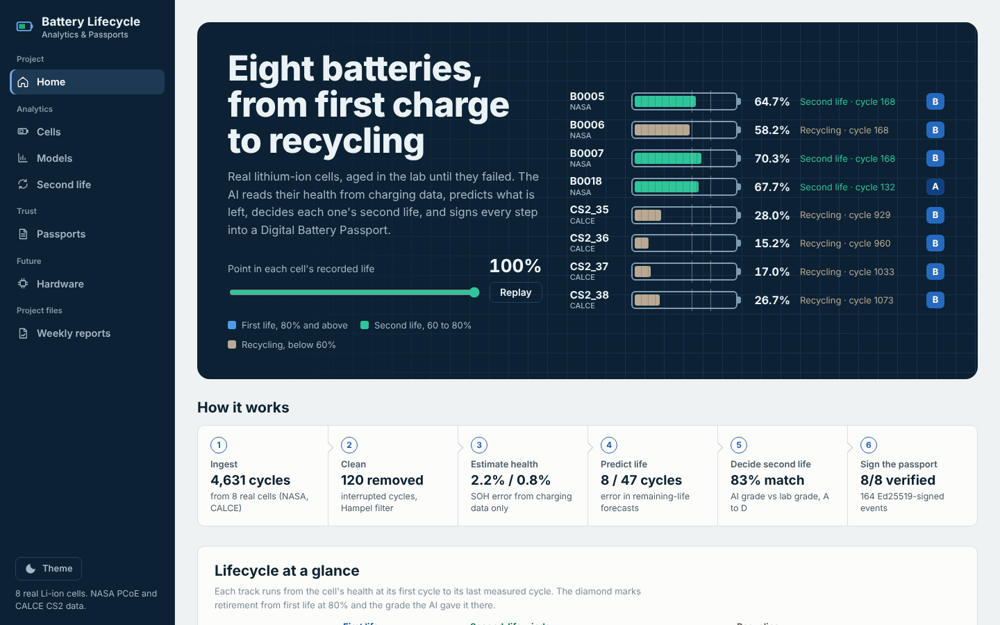
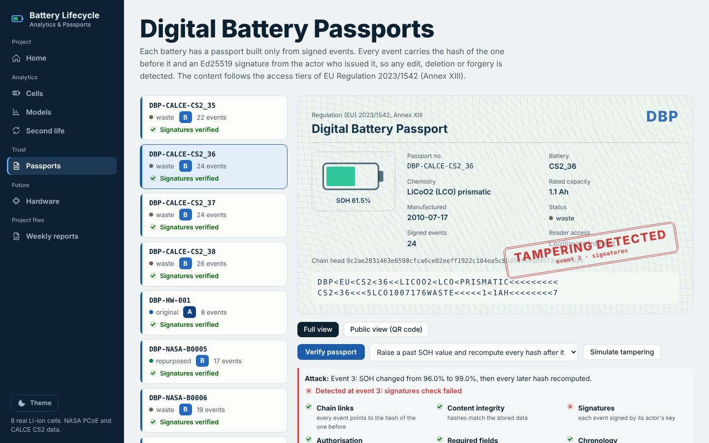
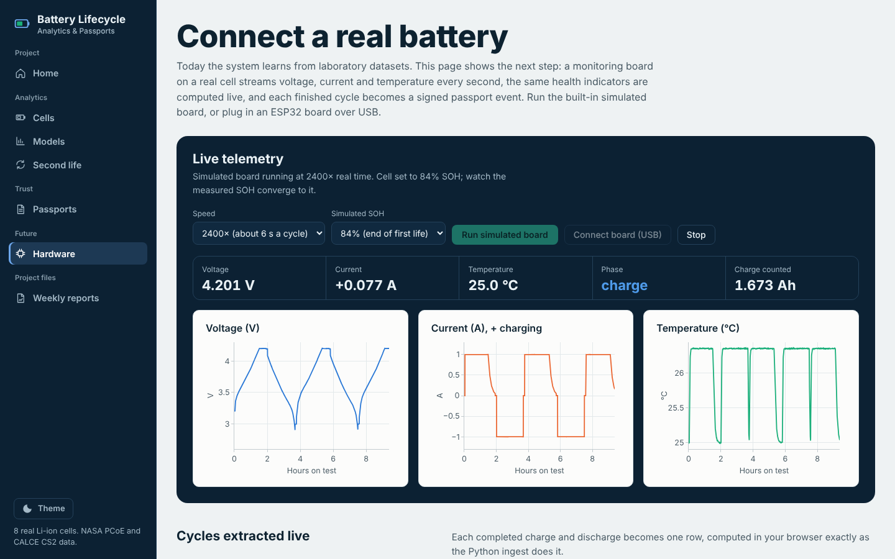
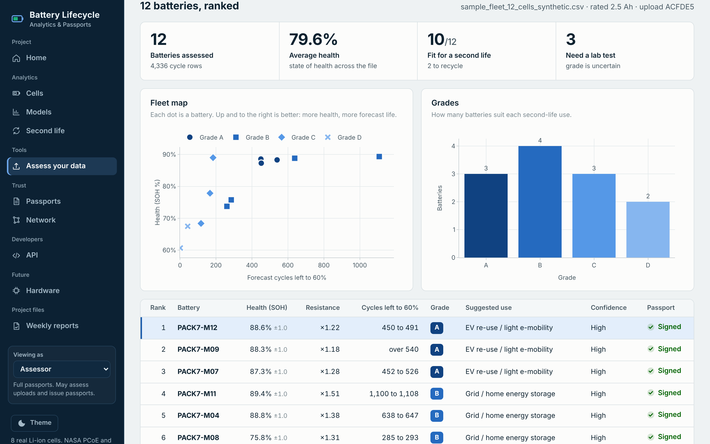
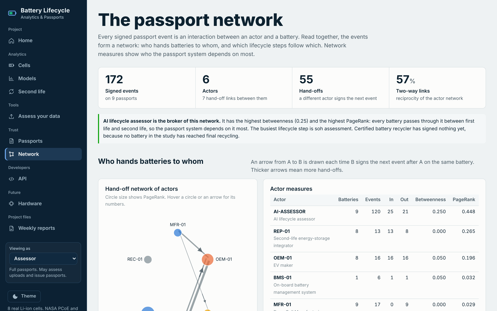

# Battery Lifecycle Analytics

**AI-Based Battery Lifecycle Assessment and Second-Life Management Using Digital Battery Passports**

[](https://github.com/aarnavbms/battery-lifecycle-analytics/actions/workflows/tests.yml)

### [Open the live website](https://aarnavbms.github.io/battery-lifecycle-analytics/) · [Weekly reports (PDF)](reports/) · [Project code](project/)



The system takes real lithium-ion ageing data and:
1. estimates each battery's **state of health (SOH)** from ordinary charging data
2. predicts its **remaining useful life (RUL)** with calibrated uncertainty
3. decides its **second life**: EV re-use, home or grid storage, backup power, or recycling
4. records every step in a **Digital Battery Passport** of SHA-256-chained, Ed25519-signed events, aligned with EU Regulation 2023/1542

Version 1.1 makes it a software platform: a **database**, a documented **REST API**, **user roles**, a tool that **assesses your own battery file**, and **network analysis** of the passport ecosystem.

It is built on **8 real cells** from NASA PCoE and CALCE CS2, **4,631 charge-discharge cycles**.

## Results (on cells the models never saw)

| Task | NASA PCoE | CALCE CS2 |
| --- | --- | --- |
| SOH estimation error (RMSE) | 2.20 %-points | 0.81 %-points |
| 95% interval coverage | 95.0% | 97.7% |
| Remaining-life error, to 80% SOH | 8.2 cycles (life about 72) | 46.6 cycles (life about 578) |
| Second-life grade matches lab grade | 87.8% | 80.0% |

- **Passports:** every one verifies. All five tested attacks are detected: edited data, re-hashed forgery, deleted event, back-dated event and impostor signature.

## The website

| Page | What it shows |
| --- | --- |
| Home | The fleet draining through its recorded life, how the system works, lifecycle at a glance |
| Cells | Measured vs estimated SOH with 95% band, RUL vs truth, health indicators, decisions |
| Models | Five SOH models and three RUL methods compared |
| Second life | Interactive grader, AI vs lab confusion matrix, rules and assumptions |
| Assess your data | Upload a CSV of battery cycles: health, forecast, grade, ranked fleet table, signed passport |
| Passports | Passport document view by role (public or full), live verification, tamper simulation, PDF with QR code |
| Network | Hand-off and process networks from the signed events, with betweenness and PageRank |
| API | 23 REST endpoints with roles, described in OpenAPI 3.0 |
| Hardware | Live telemetry console: simulated board or a real ESP32 over USB |
| Weekly reports | Seven weekly status reports as PDFs |

| Passport tamper detection | Hardware console |
| --- | --- |
|  |  |

| Assess your own data | Passport network |
| --- | --- |
|  |  |

## Software platform (version 1.1)

| Part | What it does |
| --- | --- |
| Database | SQLite, 10 tables: cells, cycles, assessments, actors, passports, events, users, uploads, audit log |
| REST API | `/api/v1`, 23 endpoints, OpenAPI 3.0, uniform JSON errors |
| Roles | Public, manufacturer, vehicle maker, assessor, repurposer, recycler, regulator, admin. Password login, 8-hour tokens. Each role may sign only its own passport event types. |
| Upload assessment | Measured health or AI estimate from charging signals, trend forecast, A to D grade, signed passport |
| Network analysis | The AI assessor is the broker of the network (betweenness 0.25, PageRank 0.45) |
| Explainability | Permutation importance on unseen cells |
| Quality | 102 automated tests, run by GitHub Actions on every push; Dockerfile included |

On this hosted site there is no server: roles are simulated in the browser, the sample files return stored results, and other files get a lighter in-browser analysis. Run the project locally for the full API. Details are in [project/docs/platform.md](project/docs/platform.md).

## Hardware integration (future option)

A bench logger (ESP32 + INA219 + DS18B20 + TP4056, about INR 1,500) streams one JSON line per second. The pipeline:
- computes capacity by coulomb counting, plus the same charging health indicators the models use
- grades the cell
- appends signed `SOH_ASSESSMENT` events to its passport

Firmware, ingest code, simulator and tests are included. Details are in [project/docs/hardware.md](project/docs/hardware.md).

## Repository layout

```
index.html, plotly.min.js   the live website (GitHub Pages)
reports/                    weekly status reports, weeks 1-7 (PDF)
passports/, samples/        PDF passports with QR codes, sample CSV files
.github/workflows/          automated tests
project/                    full source code
  batterylife/              data loaders, cleaning, features, SOH and RUL models, grading, passport, hardware
  batterylife/service/      database, roles, upload analysis, network, explainability, PDF passports
  dashboard/                Flask app and REST API (local version of the website)
  hardware/firmware/        ESP32 bench-logger firmware
  scripts/                  figures, static export, report generator
  tests/                    102 pytest tests
  docs/                     final report, architecture, dataset, hardware, sprint reports, figures
  data/processed, results/  processed data, metrics, predictions, passports
```

## Run it locally

```
cd project
pip install -r requirements.txt
python dashboard/app.py               # website and API on http://127.0.0.1:8050
python -m batterylife run --fast      # rebuild results
python -m pytest -q                   # 102 tests
```

## Data sources
- B. Saha and K. Goebel (2007). Battery Data Set, NASA Ames Prognostics Data Repository.
- CALCE Battery Research Group, University of Maryland, CS2 battery data.
