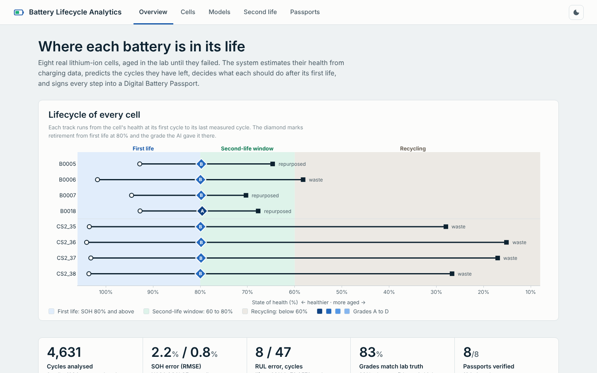

# AI-Based Battery Lifecycle Assessment and Second-Life Management Using Digital Battery Passports

An end-to-end system that estimates the health of lithium-ion batteries from charging data, predicts how long they will last, decides what each battery should do after its first life, and records every step in a signed, tamper-evident Digital Battery Passport. An offline analytics dashboard shows everything.

Built on real ageing data: **NASA PCoE** (4 cells) and **CALCE CS2** (4 cells), 4,631 charge-discharge cycles.



## Results (on cells the models never saw)

| Task | NASA | CALCE |
| --- | --- | --- |
| SOH estimation, RMSE | 2.20 %-points (Gradient Boosting) | 0.81 %-points (Gaussian Process) |
| 95% interval coverage | 95.0% | 97.7% |
| RUL to 80% SOH, mean error | 8.2 cycles (life about 72) | 46.6 cycles (life about 578) |
| Second-life grade agreement | 87.8% | 80.0% |

- **Overall grade agreement:** 83.2% over 101 decisions, 89.5% when the system is confident.
- **Passports:** 8 passports, 164 Ed25519-signed events, all valid. Every tested attack is detected: edited data, re-hashed forgery, deleted event, back-dated event and impostor signature.

**Live website:** https://aarnavbms.github.io/battery-lifecycle-analytics/

## New in this version
- **Hardware integration option:** ESP32 bench-logger firmware, telemetry protocol, cycle extraction, signed passport events, and a live telemetry page. See `docs/hardware.md`.
- **Weekly status reports** for weeks 1-7 as PDFs in `docs/reports/`, generated from the real results by `scripts/make_reports.py`.
- **New website layout:** sidebar navigation, a "How it works" strip, and Hardware and Weekly reports pages.

## Quick start (Windows, Anaconda Prompt)

```
cd "%USERPROFILE%\OneDrive\Documents\ai battery lifecycle"
pip install -r requirements.txt
python dashboard\app.py          # then open http://127.0.0.1:8050
```

Or double-click `run_dashboard.bat`. Results are included, so no training is needed to view them.

```
python -m batterylife run        # re-train everything (about 5 min)
python -m batterylife verify     # verify all passports
python -m pytest -q              # 73 tests
```

## Project layout

```
batterylife/        data loaders, cleaning, features, SOH & RUL models, grading, passport, pipeline, CLI
dashboard/          Flask app + offline Plotly UI (5 pages)
data/raw/nasa       NASA .mat files (CALCE raw: scripts/download_data.py)
data/processed/     cycle table, features, data-quality report
results/            metrics, predictions, second-life decisions, passports
docs/               final report, architecture, dataset, user guide, 10 sprint reports, figures
tests/              pytest suite
```

## Documentation
- [Final report](docs/final_report.md)
- [Architecture](docs/architecture.md)
- [Dataset](docs/dataset.md)
- [User guide](docs/user_guide.md)
- [Weekly sprint reports](docs/README.md)

## Built in 10 weekly sprints
Each sprint has a report in `docs/sprints/` and a git tag (`sprint-01` ... `sprint-10`, release `v1.0`).

## Data sources
- B. Saha and K. Goebel (2007). Battery Data Set, NASA Ames Prognostics Data Repository.
- CALCE Battery Research Group, University of Maryland, CS2 battery data.

The passport schema is aligned with Regulation (EU) 2023/1542, Article 77 and Annex XIII.
