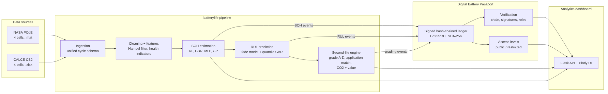

# System Architecture

**Project:** AI-Based Battery Lifecycle Assessment and Second-Life Management Using Digital Battery Passports

The system turns raw battery cycling data into a lifecycle decision (keep, re-use, repurpose or recycle) and records every step in a cryptographically signed Digital Battery Passport. A web dashboard shows all of it.



## 1. Layers

| Layer | Package | Responsibility |
| --- | --- | --- |
| Data ingestion | `batterylife/data` | Read NASA `.mat` and CALCE `.xlsx` files into one cycle-level table (`schema.py`) |
| Cleaning and features | `batterylife/features` | Remove interrupted cycles (Hampel filter), build health indicators, normalise per cell |
| Models | `batterylife/models` | SOH estimation (Ridge, Random Forest, Gradient Boosting, MLP, Gaussian Process) and RUL prediction (empirical fade model and quantile Gradient Boosting) |
| Lifecycle decisions | `batterylife/lifecycle` | Grade A-D, match to second-life applications, estimate service years, CO2 and value |
| Digital Battery Passport | `batterylife/passport` | Annex XIII-aligned schema, Ed25519-signed hash-chained event ledger, role checks, access levels, JSON store |
| Orchestration | `batterylife/pipeline.py`, `batterylife/__main__.py` | One command runs every stage and writes `results/` |
| Presentation | `dashboard/` | Flask API and analytics UI (Plotly, works offline) |
| Quality | `tests/` | pytest unit and integration tests |

## 2. Data flow

1. **Ingest:** each loader returns rows in the unified schema: one row per complete charge-discharge cycle.
2. **Clean:** a rolling Hampel filter flags cycles whose capacity deviates more than 3 robust standard deviations from the local median (interrupted or partial cycles). Charge features are repaired the same way.
3. **Feature engineering:** health indicators that a battery management system (BMS) can observe during normal charging:
   - constant-current (CC) charge time
   - constant-voltage (CV) charge time
   - time for the voltage to rise from 3.9 V to 4.2 V
   - internal resistance
   - cycle count

   Each indicator is also expressed relative to the cell's own first cycles, so cells and datasets can be compared. Discharge capacity and discharge time are **not** used as SOH inputs, because they are the label itself.
4. **SOH estimation:** leave-one-cell-out cross-validation inside each dataset. The Gaussian Process gives a confidence interval for every estimate.
5. **RUL prediction:** cycles until SOH falls to 80% (first-life end). Two approaches are compared:
   - a double-exponential fade model fitted on the history seen so far and extrapolated
   - quantile Gradient Boosting that gives 10%, 50% and 90% estimates
6. **Second-life assessment:** at retirement each cell is graded on estimated SOH, resistance growth and predicted second-life cycles, then matched to the best application. Value, service years and CO2 avoided are computed.
7. **Passport:** every stage writes a signed event. Verification checks:
   - the hash chain
   - each Ed25519 signature
   - whether the signing actor's role may issue that event type
8. **Dashboard:** reads `results/` and serves the analytics, the passport viewer and live verification.

## 3. Digital Battery Passport design

Regulation (EU) 2023/1542 requires a passport for EV, light-means-of-transport and industrial batteries above 2 kWh from **18 February 2027**. Annex XIII lists the data and who may see it. This project models a simplified, aligned subset:

| Section | Example fields | Access |
| --- | --- | --- |
| Identity and general information | passport ID, model, manufacturer, chemistry, rated capacity, manufacture date | Public |
| Carbon footprint | manufacturing kg CO2e per kWh and total | Public |
| Performance and durability | rated capacity, expected cycle life, initial internal resistance | Public |
| State of health | latest SOH and confidence interval, resistance growth, RUL | Legitimate interest |
| Battery status | original, repurposed, re-used, remanufactured, waste | Public |
| Lifecycle event ledger | signed events from manufacturer, BMS, assessor, repurposer, recycler | Legitimate interest |

**Integrity model**
- Each event stores `prev_hash` = SHA-256 of the previous event, so editing any past event breaks every later link.
- Each event is signed with the issuing actor's Ed25519 private key. A forged event, even with a valid hash chain, fails signature checks.
- A role table states which actor may issue which event; for example, only an assessor may issue `SECOND_LIFE_GRADING`.
- This is a single-store, tamper-evident ledger, not a distributed blockchain. Anchoring the chain head on a public ledger is listed as future work.

## 4. Repository layout

```
ai battery lifecycle/
  batterylife/            Python package
    config.py             paths, datasets, thresholds, application catalogue
    data/                 schema.py, nasa.py, calce.py, registry.py
    features/             cleaning.py, indicators.py
    models/               soh.py, rul.py, evaluation.py
    lifecycle/            grading.py, sustainability.py
    passport/             schema.py, crypto.py, ledger.py, store.py
    pipeline.py           end-to-end orchestration
    __main__.py           command line: python -m batterylife ...
  dashboard/              Flask app, templates, static (offline Plotly)
  data/raw/               NASA .mat (bundled), CALCE .xlsx (scripts/download_data.py)
  data/processed/         cycle tables and features (CSV)
  results/                metrics, predictions, passports (JSON)
  docs/                   this file, dataset notes, sprint reports, final report
  tests/                  pytest suite
```

## 5. Technology choices

| Need | Choice | Why |
| --- | --- | --- |
| Language | Python 3.10+ | Standard for data science; available in Anaconda |
| ML | scikit-learn | Small tabular data; fast; interpretable; no GPU needed |
| Curve fitting | SciPy `curve_fit` | Classic empirical fade models |
| Signatures | `cryptography` (Ed25519) | Modern, fast, small keys |
| Web | Flask + Plotly.js | Light, runs offline, interactive charts |
| Tests | pytest | Simple, widely used |
