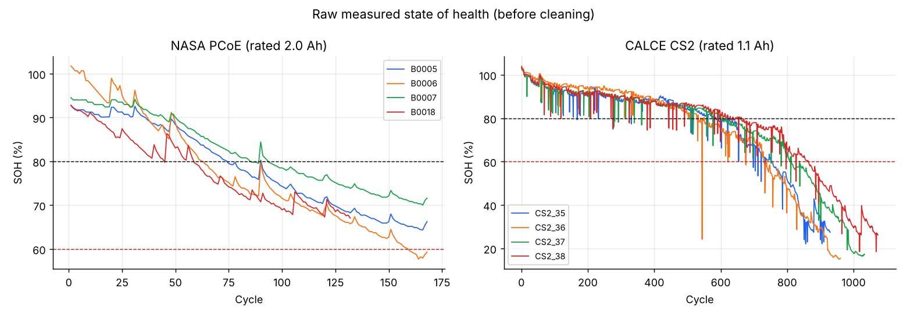

# Datasets

The project uses two public Li-ion ageing datasets, 8 cells in total. Together they give 4,631 complete charge-discharge cycles.

## NASA PCoE Battery Data Set

| Item | Value |
| --- | --- |
| Source | B. Saha and K. Goebel (2007), Battery Data Set, NASA Ames Prognostics Data Repository |
| Cells | B0005, B0006, B0007, B0018 (18650, rated 2.0 Ah) |
| Temperature | 24 C ambient |
| Charge | CC 1.5 A to 4.2 V, then CV until current falls to 20 mA |
| Discharge | CC 2 A to 2.7 / 2.5 / 2.2 / 2.5 V |
| Impedance | EIS sweep 0.1 Hz - 5 kHz; electrolyte resistance Re and charge-transfer resistance Rct |
| Stop criterion | 30% capacity fade (2.0 to 1.4 Ah) |
| Cycles used | 168, 168, 168, 132 |
| SOH range | 102% to 58% |
| Files | `data/raw/nasa/B0005.mat` ... (bundled, 54 MB) |

## CALCE CS2 dataset

| Item | Value |
| --- | --- |
| Source | CALCE Battery Research Group, University of Maryland |
| Cells | CS2_35, CS2_36, CS2_37, CS2_38 (LiCoO2 prismatic, rated 1.1 Ah) |
| Charge | CC 0.55 A (0.5C) to 4.2 V, then CV until 0.05 A |
| Discharge | CC 1.1 A (1C) to 2.7 V |
| Extra signal | Arbin internal resistance on every cycle |
| Cycles used | 929, 960, 1,033, 1,073 |
| SOH range | 104% to 15% |
| Files | 100 Arbin `.xlsx` exports, about 170 MB, fetched by `scripts/download_data.py` |

## Unified cycle table

`batterylife/data/schema.py` defines one row per complete cycle. The loaders produce:

| Column | NASA | CALCE | Meaning |
| --- | --- | --- | --- |
| capacity_ah, soh | yes | yes | Measured discharge capacity; SOH = capacity / rated |
| cc_charge_time_s | yes | yes | Duration of constant-current charging |
| cv_charge_time_s | yes | yes | Duration of constant-voltage charging |
| charge_v_rise_s | yes | yes | Time to rise from 3.9 V to 4.2 V while charging |
| discharge_time_s, mean_discharge_v, discharge_energy_wh | yes | yes | Discharge-side measurements (not used as SOH inputs) |
| resistance_ohm | Re + Rct from EIS, interpolated in time | Arbin internal resistance | Ohmic and charge-transfer resistance |
| temp_max_c, temp_rise_c, ambient_c | yes | no | Surface temperature |

Output: `data/processed/cycles_raw.csv` (4,631 rows) and `data/processed/data_quality.json`.

## Data quality findings

| Finding | Where | Handling |
| --- | --- | --- |
| Interrupted or partial discharge cycles show as sudden SOH drops | CALCE, all cells | Hampel filter in Sprint 3 flags and excludes them |
| Capacity jumps up after long rests (regeneration) | NASA, every cell around cycles 30, 48, 90 | Real electrochemical effect; kept |
| First charge before cycle 1 is partial | NASA | Charge features repaired by the same filter |
| Resistance sensor plateau at 0.15 ohm, cycles 30-140 | CALCE CS2_38 | Kept but down-weighted by the robust baseline |
| Fresh cells exceed rated capacity (SOH up to 104%) | Both | SOH is kept relative to rated capacity, as the regulation defines it |
| No temperature in CALCE | CALCE | Temperature features used only in NASA analysis |
| 3.9-4.2 V rise time missing when a charge starts above 3.9 V | 9-13% of CALCE cycles | Filled by interpolation within the cell |
