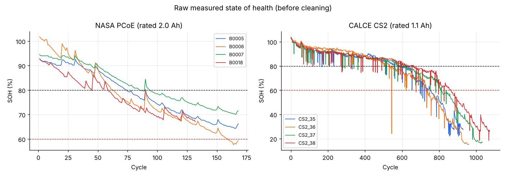
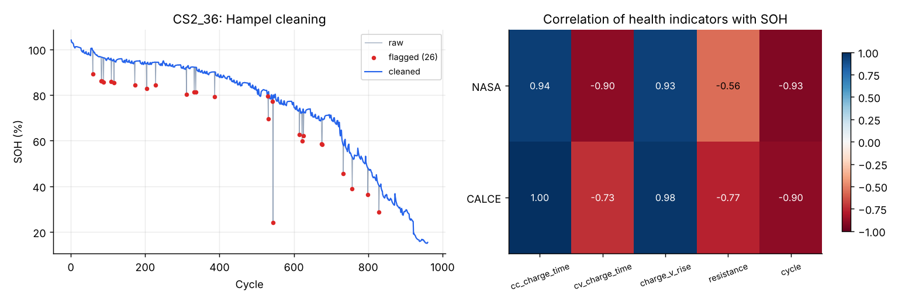
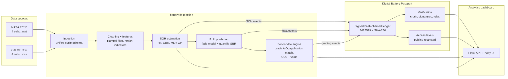
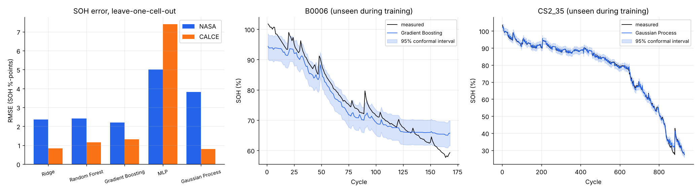
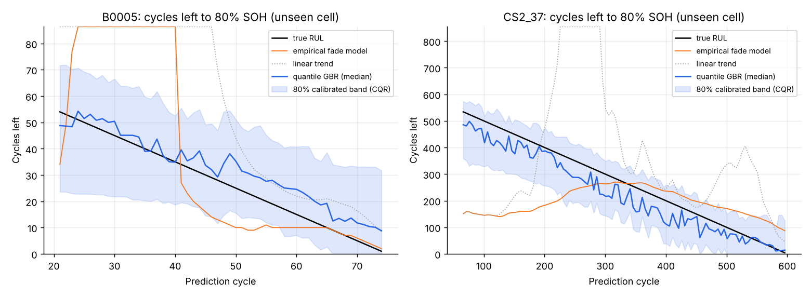
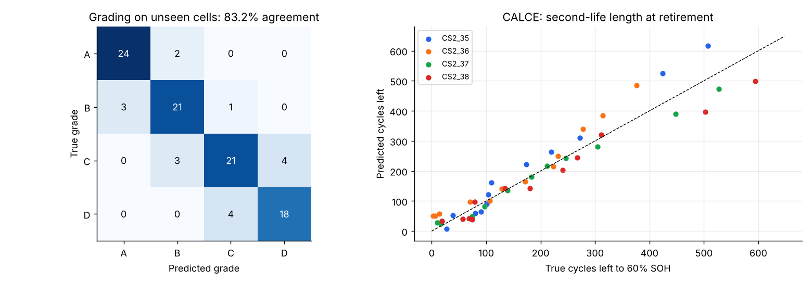
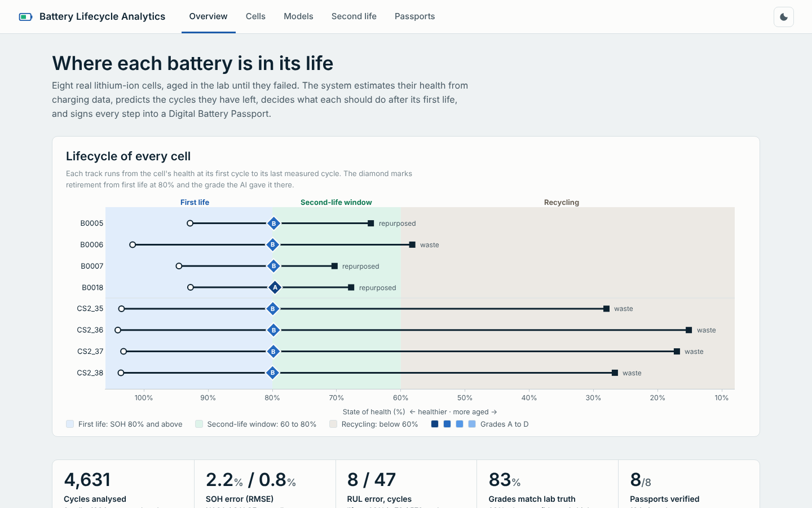

# AI-Based Battery Lifecycle Assessment and Second-Life Management Using Digital Battery Passports

**Final project report** · Subject: SNA · Version 1.0 · Codebase tag `v1.0`

---

## Abstract

Electric-vehicle batteries are retired when they fall to about 80% of their rated capacity, yet most can still work for years in less demanding jobs. Deciding which battery goes where needs a trustworthy record of its health. From February 2027 the EU will require such a record, a digital battery passport, for EV, light-vehicle and industrial batteries.

This project builds an end-to-end system on real ageing data from 8 lithium-ion cells (NASA PCoE and CALCE CS2, 4,631 cycles). It has four parts:
- **SOH estimation** from charging signals alone, with calibrated 95% intervals. RMSE on cells the model never saw is 2.2 percentage points (NASA) and 0.81 (CALCE).
- **RUL prediction** with calibrated 80% bands. Mean error is 8 cycles on a 72-cycle life (NASA) and 47 cycles on a 578-cycle life (CALCE).
- **An uncertainty-aware second-life grader.** It matches lab-truth grades in 83% of 101 decisions, 89% when confident, and flags most of its own mistakes for a lab test.
- **A Digital Battery Passport** built from Ed25519-signed, hash-chained events. All five tested attacks are detected.

An offline web dashboard presents every result.

---

## 1. Introduction

### 1.1 Problem
A battery's value after its first life depends on three questions: how healthy is it now, how long will it last, and can anyone trust the answers? Today these are answered by slow full-discharge tests, and the results rarely travel with the battery.

### 1.2 Objectives
1. Estimate state of health (SOH) from signals a battery management system (BMS) sees during normal charging.
2. Predict remaining useful life (RUL) to first-life end (80% SOH) and second-life end (60% SOH), with uncertainty.
3. Grade retired batteries and match them to a second-life application, quantifying CO2 and economic value.
4. Record the whole lifecycle in a tamper-evident Digital Battery Passport aligned with EU rules.
5. Present everything in an analytics interface.

### 1.3 Regulatory context
Regulation (EU) 2023/1542 (the Batteries Regulation) requires a battery passport, reachable through a QR code, for EV, light-means-of-transport and industrial batteries above 2 kWh placed on the EU market from 18 February 2027. Annex XIII lists the content and splits access between the general public, persons with a legitimate interest (such as repairers, repurposers and recyclers) and authorities. The regulation's battery statuses are original, repurposed, re-used, remanufactured and waste. This project models a simplified subset of that content and those access tiers.

## 2. Data

| | NASA PCoE | CALCE CS2 |
| --- | --- | --- |
| Cells | B0005, B0006, B0007, B0018 | CS2_35, CS2_36, CS2_37, CS2_38 |
| Chemistry, format | Li-ion 18650, 2.0 Ah | LiCoO2 prismatic, 1.1 Ah |
| Protocol | CC 1.5 A / CV 4.2 V charge; 2 A discharge; EIS impedance | CC 0.55 A / CV 4.2 V charge; 1.1 A discharge; Arbin resistance |
| Cycles | 636 | 3,995 |
| SOH range | 102% to 58% | 104% to 15% |

The two datasets complement each other:
- NASA adds impedance and temperature.
- CALCE covers the whole first and second life down to recycling, which gives ground truth for second-life predictions.

Details are in `docs/dataset.md`.

## 3. Method

### 3.1 Cleaning
- **Capacity:** a one-sided Hampel filter (11-cycle window, max of 3 x MAD or 1.5 percentage points, two passes) removes interrupted discharges. It removed 120 CALCE cycles (3.0%) and no NASA cycles, so NASA's real capacity-regeneration jumps after rest periods are kept.
- **Charge features:** a two-sided Hampel filter repairs spikes in charge-phase features.
- **End of life:** decided on a 9-cycle rolling median, so one noisy cycle cannot trigger it.

### 3.2 Health indicators
All SOH inputs come from an ordinary charge:
- constant-current (CC) charge time
- constant-voltage (CV) charge time
- time to rise from 3.9 to 4.2 V
- resistance
- cycle count

Discharge capacity is never an input, because it is the label. A **partial-charge** variant drops CC charge time, for vehicles that rarely charge from empty.

### 3.3 SOH estimation
- **Models:** Ridge, Random Forest, Gradient Boosting, MLP and Gaussian Process.
- **Validation:** leave-one-cell-out (LOCO) inside each dataset. The model is trained on three cells and tested on the fourth, then rotated.
- **Production model:** the model with the lowest LOCO RMSE in each dataset.
- **Uncertainty:** split-conformal prediction. For each held-out cell, the 95th percentile of errors from LOCO on the training cells sets the interval half-width (Vovk et al., 2005).

### 3.4 RUL prediction
At each prediction cycle k, the predictor sees only the out-of-sample SOH estimates for cycles 1..k (median-smoothed, causal) and the charge signals. Three methods are compared:

| Method | Idea |
| --- | --- |
| Linear trend | Straight line through recent estimated SOH |
| Empirical fade model | soh(k) = p0 − p1·k − p2·(e^(p3·k) − 1): linear loss plus an accelerating knee, fitted per cell |
| Quantile Gradient Boosting | 10/50/90% quantiles of RUL from current SOH estimate, fade rate, fade acceleration, charge signals, resistance and cycle count, trained on the other cells |

Quantile bands are calibrated with conformalised quantile regression (CQR; Romano et al., 2019), using inner LOCO on the training cells.

### 3.5 Second-life grading

| Grade | Application | Min SOH | Max resistance growth | Min cycles left to 60% |
| --- | --- | --- | --- | --- |
| A | EV re-use / light e-mobility | 80% | x1.30 | 300 |
| B | Grid / home energy storage | 70% | x1.60 | 200 |
| C | Backup power (telecom, UPS) | 60% | x2.00 | 50 |
| D | Recycling | otherwise | | |

The grade is recomputed with the lower 95% bound of SOH and the lower bound of cycles left. If it changes, the decision is **low-confidence** and a laboratory capacity test is recommended.

The value model scales each decision to a 60 kWh pack. It uses 75 kg CO2e per kWh, a mid value of the 61-106 kg CO2e/kWh that IVL reports for NMC production, plus stated price assumptions. CO2 avoided is an upper bound that assumes full displacement of a new battery.

The grader is evaluated at 15 retirement levels from 90% to 55% SOH on every cell, using LOCO estimates only. Its grade is compared with the grade computed from measured SOH and the cell's real remaining cycles.

### 3.6 Digital Battery Passport
- Every piece of content enters through a **signed event**.
- Each event stores `prev_hash`, the SHA-256 of the previous event, and an **Ed25519 signature** (Bernstein et al., 2012) by the issuing actor.
- Six roles: manufacturer, oem, bms, assessor, repurposer, recycler. Ten event types, each restricted to certain roles and tagged **public** or **restricted**.
- **Verification** checks chain links, content hashes, signatures, role authorisation, required fields and chronology.
- The **public view** omits restricted sections and events, mirroring Annex XIII's tiers.

For the 8 cells the measurements and test timestamps are real. The surrounding actors (manufacturer, vehicle maker, repurposer, recycler) are simulated so the full workflow can be shown.

### 3.7 Architecture

The system is a Python package (`batterylife`) with layers for data, features, models, lifecycle and passport, a 7-stage pipeline with a command-line interface, a Flask dashboard and 61 pytest tests. See `docs/architecture.md`.

## 4. Results

### 4.1 SOH estimation (RMSE in SOH percentage points, unseen cells)

| Model | NASA full | NASA partial | CALCE full | CALCE partial |
| --- | --- | --- | --- | --- |
| Ridge | 2.35 | 2.96 | 0.83 | 5.87 |
| Random Forest | 2.41 | 2.49 | 1.15 | 1.96 |
| Gradient Boosting | **2.20** | 2.49 | 1.32 | 2.07 |
| MLP | 5.01 | 7.07 | 7.40 | 3.28 |
| Gaussian Process | 3.82 | 4.20 | **0.81** | 3.83 |

| Dataset | Production model | MAE | R² | 95% interval coverage |
| --- | --- | --- | --- | --- |
| NASA | Gradient Boosting | 1.64% | 0.951 | 95.0% |
| CALCE | Gaussian Process | 0.47% | 0.999 | 97.7% |

### 4.2 RUL prediction

| Target | Dataset | Mean life | Linear MAE | Fade-model MAE | **Quantile GBR MAE** | 80% band coverage (raw → CQR) |
| --- | --- | --- | --- | --- | --- | --- |
| 80% SOH | NASA | 72 cycles | 78.9 | 55.9 | **8.2** | 24% → 76% |
| 80% SOH | CALCE | 578 cycles | 388.8 | 145.4 | **46.6** | 23% → 79% |
| 60% SOH | CALCE | 791 cycles | 499.4 | 352.8 | **55.4** | 33% → 84% |

### 4.3 Second-life decisions (101 decisions on unseen cells)

| Metric | Value |
| --- | --- |
| Grade agreement with lab truth | 83.2% (NASA 87.8%, CALCE 80.0%) |
| Agreement when confidence is high | 89.5% |
| Errors already flagged low-confidence | 64.7% |
| Conservative / optimistic errors | 7 / 10 |
| Second-life length error (CALCE) | 33.6 cycles |
| At 80% retirement | 7 cells grade B, 1 cell grade A |
| Per 60 kWh pack at 80% retirement | about 3.6 t CO2e avoided (upper bound), about USD 2,480 re-use value |

### 4.4 Passports
- 8 passports, 164 signed events, 8 of 8 valid.

| Attack | Result |
| --- | --- |
| Edit a past SOH value | Detected (content hash) |
| Edit and recompute every hash | Detected (signature) |
| Delete an event | Detected (chain) |
| Back-date an event | Detected (chronology) |
| Re-sign with another actor's key | Detected (signature) |

### 4.5 Dashboard

## 5. Discussion

**What worked**
- **Charge-phase signals carry most of the health information.** CC charge time and the 3.9-4.2 V rise time explain 77-97% of the Gradient Boosting model's importance.
- **Calibration matters as much as accuracy.** Uncalibrated intervals looked plausible but covered only 22-66% of truth. Conformal methods brought coverage to the targets without touching the held-out cell.
- **Learned RUL beats curve extrapolation.** Fade curves fitted before the CALCE knee cannot know when it comes, and NASA's regeneration jumps flatten fitted trends. The quantile model learns these patterns from the other cells.
- **Honest uncertainty makes grading safer.** Most wrong grades sit at a grade boundary, exactly where the confidence flag fires.

**Limitations**
1. **Small sample.** There are 4 cells per dataset. Every error figure has wide uncertainty, and the production model was picked on the same folds it is scored on.
2. **Laboratory ageing is harsh.** Full depth of discharge and 1-2C rates make lives short (72-578 cycles to 80%), so service-year estimates are relative rankings, not forecasts.
3. **Tree models cannot extrapolate.** B0006 fades below every NASA training cell and its estimate flattens near 66%.
4. **CALCE charges from empty,** so CC charge time is almost a direct capacity measure. The partial-charge results (RMSE 2.0-2.5%) are the realistic figure for vehicles.
5. **Datasets are modelled separately.** One model across chemistries was not attempted.
6. **The passport is a single-store ledger.** It proves integrity and authorship but cannot stop deletion of a whole file. Grade thresholds and value coefficients are assumptions, not standards.

## 6. Future work
- Add more cells: the CALCE CX2 series, the Oxford ageing data, and MIT/Toyota fast-charge cells.
- Transfer learning across chemistries.
- Physics-informed models (equivalent-circuit parameters, incremental-capacity features).
- Anchor each passport's head hash on a public ledger or registry. Add QR access and role-based login.
- Replace assumed grade thresholds with criteria from repurposing standards such as UL 1974, and add a full cost model.

## 7. Conclusion
The project shows that a battery's health and remaining life can be estimated from routine charging data with calibrated uncertainty. It shows that those estimates can drive a safe, explainable second-life decision. And it shows that the whole history can be carried in a passport that exposes any tampering. Every claim is checked on cells the models never saw, and the system runs end to end with one command.

## 8. Sprint summary

| Sprint | Planned week | Delivered |
| --- | --- | --- |
| 1 | 2-6 Nov | Scope, architecture, data acquisition |
| 2 | 9-13 Nov | NASA and CALCE loaders, 4,631 validated cycles |
| 3 | 16-20 Nov | Hampel cleaning, health indicators |
| 4 | 23-27 Nov | SOH models, conformal intervals |
| 5 | 30 Nov-4 Dec | RUL models, CQR calibration |
| 6 | 7-11 Dec | Grading, application matching, value |
| 7 | 14-18 Dec | Signed hash-chained passport |
| 8 | 21-25 Dec | Pipeline, CLI, 8 passports |
| 9 | 28 Dec-1 Jan | Analytics dashboard |
| 10 | 4-8 Jan | Report, documentation, release v1.0 |

Each sprint has its own report in `docs/sprints/` and a git tag (`sprint-01` ... `sprint-10`).

## References
- Saha, B. and Goebel, K. (2007). *Battery Data Set.* NASA Ames Prognostics Data Repository, NASA Ames Research Center.
- CALCE Battery Research Group. *CS2 Battery Data.* Center for Advanced Life Cycle Engineering, University of Maryland.
- Regulation (EU) 2023/1542 of the European Parliament and of the Council concerning batteries and waste batteries (Article 77, Annex XIII).
- IVL Swedish Environmental Research Institute. Lithium-ion vehicle battery production: 61-106 kg CO2e per kWh for NMC cells (as reported by Transport & Environment).
- Vovk, V., Gammerman, A. and Shafer, G. (2005). *Algorithmic Learning in a Random World.* Springer.
- Romano, Y., Patterson, E. and Candès, E. (2019). Conformalized Quantile Regression. *NeurIPS.*
- Bernstein, D. J., Duif, N., Lange, T., Schwabe, P. and Yang, B.-Y. (2012). High-speed high-security signatures. *Journal of Cryptographic Engineering.*
- Pedregosa, F. et al. (2011). Scikit-learn: Machine Learning in Python. *JMLR* 12.
