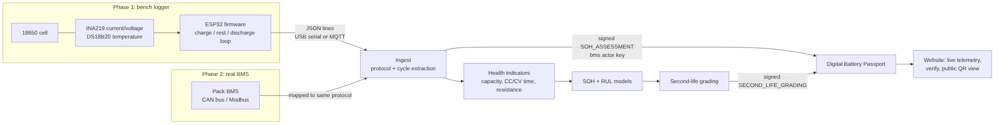

# Hardware Integration (Future Option)

The current system runs on laboratory datasets. This document shows how to connect it to **real batteries**, from one cell on a desk to a fleet of packs. The software side is already built and tested: telemetry protocol, cycle extraction, signed passport recording and a live web page. The hardware can be added later without changing the models or the passport.



## 1. What is already built

| Part | File | Status |
| --- | --- | --- |
| Telemetry protocol (one JSON line per second) | `batterylife/hardware/protocol.py` | Done, tested |
| Cell simulator (stands in for the board) | `batterylife/hardware/simulator.py` | Done, tested |
| Cycle extraction (coulomb counting, CC/CV times, resistance) | `batterylife/hardware/cycler.py` | Done, tested |
| Ingest from log file or serial port, grade, sign passport events | `batterylife/hardware/ingest.py` | Done, tested |
| ESP32 firmware for a bench logger | `hardware/firmware/battery_logger/battery_logger.ino` | Written, needs a board to flash |
| Live telemetry page with Web Serial (Chrome / Edge) | Website, Hardware tab | Done; simulator runs in any browser |

```
python -m batterylife.hardware simulate --cycles 6 --soh 0.86 --out hardware/sample_logs/sim.jsonl
python -m batterylife.hardware ingest --log hardware/sample_logs/sim.jsonl --rated 2.0
python -m batterylife.hardware ingest --serial COM3 --rated 2.0        # real board, needs: pip install pyserial
```

Tested on the simulator: for a cell set to 84% SOH, coulomb counting measured 83.6%, and resistance came out within 1% of the true value.

## 2. Phase 1: bench logger for one 18650 cell (about INR 1,500)

| Part | Purpose | Approx. price (India) |
| --- | --- | --- |
| ESP32 DevKit (WROOM-32) | Controller, USB serial, Wi-Fi | INR 350-450 |
| INA219 module (or INA226 for higher accuracy) | Bidirectional current and voltage | INR 150-250 |
| DS18B20 waterproof probe + 4.7 kOhm resistor | Cell temperature | INR 100-150 |
| TP4056 module with protection (DW01) | CC-CV charger, 1 A | INR 40-80 |
| IRLZ44N logic-level MOSFET + 3.9 Ohm 10 W resistor | Switched discharge load, about 1 A | INR 80-120 |
| 18650 holder, used 18650 cell, wires, fuse holder + 3 A fuse | Test cell and safety | INR 200-400 |
| Fire-safe container (metal box or LiPo bag) | Safety during unattended cycling | INR 200-300 |

**Wiring**

| From | To |
| --- | --- |
| Cell + | Fuse, then INA219 VIN+ |
| INA219 VIN- | Junction J (TP4056 OUT+ and load resistor) |
| Load resistor other end | MOSFET drain; source to Cell - (common ground) |
| MOSFET gate | ESP32 GPIO 26 (with a 10 kOhm pull-down) |
| TP4056 CE / input switch | ESP32 GPIO 27 |
| INA219 SDA / SCL | ESP32 GPIO 21 / 22 |
| DS18B20 data | ESP32 GPIO 4 (4.7 kOhm pull-up to 3.3 V); probe taped to the cell |

The firmware repeats charge, rest, discharge, rest on its own and streams readings every second. The ingest script turns every completed cycle into a cycle row, records a signed `SOH_ASSESSMENT` from the `bms` actor, and re-grades the cell.

**Calibration:** the INA219's default range is 400 mA. For a 0.1 Ohm shunt and 1 A currents, set a 2 A calibration. Then check against a multimeter at 0.5 A and 1 A; a 1% current error becomes about a 1% SOH error.

## 3. Phase 2: real battery management systems (BMS)

Production packs already measure everything this project needs. Instead of a custom board:
- **CAN bus:** read cell voltages, pack current, temperature and the BMS's own SOH over CAN with an MCP2515 module or a USB-CAN adapter (`python-can`), and map the messages to the same protocol.
- **Modbus / RS-485:** many stationary-storage BMS units (second-life use) expose registers over Modbus RTU; poll them with `pymodbus`.
- **Charging-cycle features:** the models use CC time, CV time and the 3.9-4.2 V rise time, which any BMS logs during routine charging, so no full discharge test is needed.

## 4. Phase 3: fleet scale and the passport registry

| Layer | Option |
| --- | --- |
| Device to cloud | MQTT over TLS (ESP32 Wi-Fi, or a 4G gateway on vehicles) |
| Broker | Mosquitto or a managed IoT hub |
| Storage | Time-series database (TimescaleDB or InfluxDB) |
| Analytics | This pipeline as a scheduled job: features, SOH, RUL, grading |
| Passport | Each board or BMS gets its own Ed25519 key (`bms` role); the head hash of each passport is anchored in the national or EU battery passport registry |
| Users | QR code on the pack opens the public view; repurposers and recyclers log in for the restricted view |

## 5. Safety rules
1. Use protected cells or a protection board; keep a fuse on the cell's positive lead.
2. The firmware stops at V > 4.25 V, V < 2.50 V or T > 55 C. Do not remove these limits.
3. Cycle cells inside a fire-safe container and never charge a swollen, dented or hot cell.
4. Second-life packs above 60 V DC need certified high-voltage practice; this bench design is for single cells only.
