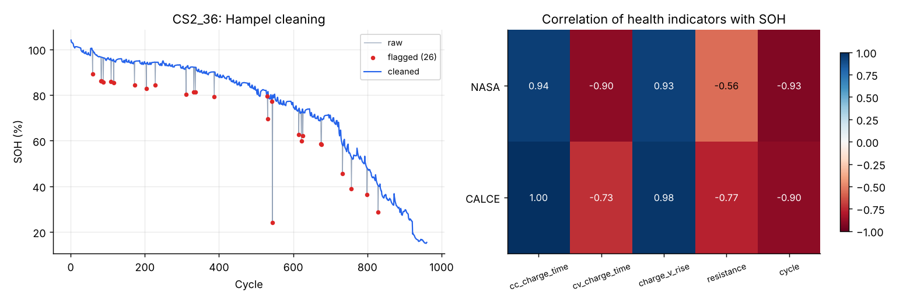

# Sprint 3: Data Cleaning and Health Indicators

**Planned week:** Week 3 (Mon 16 Nov - Fri 20 Nov 2026) · **Git tag:** `sprint-03`

## Sprint goal
Remove measurement artefacts and build health indicators a battery management system can observe during normal charging.

## Backlog

| Item | Status |
| --- | --- |
| One-sided Hampel filter for capacity | Done |
| Two-sided Hampel repair for charge features | Done |
| Smoothed SOH for end-of-life detection | Done |
| Relative (per-cell baseline) features | Done |
| Correlation analysis and figure | Done |
| Unit tests | Done (7 new, 12 total) |

## What was built

| File | Purpose |
| --- | --- |
| `batterylife/features/cleaning.py` | `hampel_flags`, `clean_capacity`, `repair_feature`, `clean_cell` |
| `batterylife/features/indicators.py` | `build_features`, `load_features`, `correlation_table`; writes `data/processed/features.csv` |
| `tests/test_features.py` | Synthetic drop and regeneration cases, spike repair, data checks |

## Method
- **Capacity outliers:** flag a cycle when SOH falls more than max(3 x MAD, 1.5 %-points) below the rolling median of 11 cycles. Two passes catch clusters of bad cycles. Only drops are flagged.
- **Feature spikes:** values beyond 3.5 x MAD of a 9-cycle median are replaced by that median; remaining gaps are interpolated.
- **Relative features:** each indicator is divided by the median of the cell's first 10 valid cycles.
- **End-of-life label:** a 9-cycle rolling median (`soh_smooth`) decides when a cell crosses 80% or 60%, so a single noisy cycle cannot trigger it.

## Results

| Indicator | Correlation with SOH, NASA | Correlation with SOH, CALCE |
| --- | --- | --- |
| CC charge time (relative) | 0.94 | 1.00 |
| 3.9-4.2 V rise time (relative) | 0.93 | 0.98 |
| CV charge time (relative) | -0.90 | -0.73 |
| Resistance (relative) | -0.56 | -0.77 |
| Cycle count | -0.93 | -0.90 |
| Temperature rise | -0.67 | n/a |

- Outliers flagged: 0 of 636 NASA cycles, so regeneration jumps are kept; 120 of 3,995 CALCE cycles (3.0%).

## Issues and decisions
- In CALCE the cells charge from empty, so CC charge time almost equals capacity (r = 1.00). A real vehicle rarely charges from empty. Sprint 4 therefore also tests a **partial-charge** feature set without CC charge time: 3.9-4.2 V rise, CV time, resistance and cycle.
- The CS2_38 resistance plateau (cycles 30-140) survives cleaning because it is long, not a spike. It is documented as a sensor artefact.

## Next sprint
SOH estimation models with leave-one-cell-out validation and confidence intervals.
