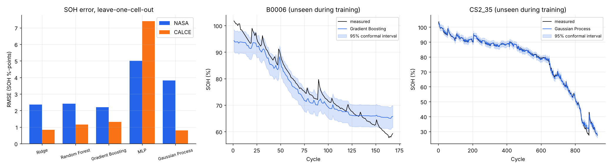

# Sprint 4: SOH Estimation Models

**Planned week:** Week 4 (Mon 23 Nov - Fri 27 Nov 2026) · **Git tag:** `sprint-04`

## Sprint goal
Estimate state of health from charge-phase signals, with honest validation and calibrated uncertainty.

## Backlog

| Item | Status |
| --- | --- |
| Leave-one-cell-out (LOCO) evaluation harness | Done |
| Five models: Ridge, Random Forest, Gradient Boosting, MLP, Gaussian Process | Done |
| Relative vs absolute feature comparison | Done |
| Partial-charge feature set | Done |
| Conformal 95% intervals | Done |
| Save production models | Done (`results/models/soh_<dataset>.joblib`) |
| Tests | Done (4 new, 16 total) |

## What was built

| File | Purpose |
| --- | --- |
| `batterylife/models/evaluation.py` | MAE, RMSE, R², max error, bias, interval coverage |
| `batterylife/models/soh.py` | Model zoo, LOCO, conformal calibration, primary-model selection, result export |
| `tests/test_soh.py` | Toy-data LOCO and coverage tests, performance targets on saved results |
| `results/soh_metrics.json`, `results/soh_predictions.csv` | Metrics and out-of-sample estimates for every cycle |

## Method
- **Inputs (full charge):**
  - CC charge time
  - CV charge time
  - 3.9-4.2 V rise time
  - resistance
  - cycle count
- **Inputs (partial charge):** the same without CC charge time.
- **Validation:** each cell is predicted by a model trained only on the other three cells of its dataset.
- **Intervals:** split-conformal. For each held-out cell, the primary model is cross-validated on the training cells only, and the 95th percentile of those errors becomes the interval half-width.

## Results (RMSE in SOH percentage points, unseen cells)

| Model | NASA full | NASA partial | CALCE full | CALCE partial |
| --- | --- | --- | --- | --- |
| Ridge | 2.35 | 2.96 | 0.83 | 5.87 |
| Random Forest | 2.41 | 2.49 | 1.15 | 1.96 |
| **Gradient Boosting** | **2.20** | 2.49 | 1.32 | 2.07 |
| MLP | 5.01 | 7.07 | 7.40 | 3.28 |
| **Gaussian Process** | 3.82 | 4.20 | **0.81** | 3.83 |

| Dataset | Primary model | MAE | R² | 95% interval coverage |
| --- | --- | --- | --- | --- |
| NASA | Gradient Boosting | 1.64 % | 0.951 | 95.0% |
| CALCE | Gaussian Process | 0.47 % | 0.999 | 97.7% |

Feature importance (Gradient Boosting): CC charge time and the 3.9-4.2 V rise time carry 77-97% of it. Resistance carries under 1%, because the charge-time signals already encode its effect.

## Issues and decisions
- **Relative features hurt NASA** (RMSE 4.1% vs 2.2%). NASA cells start at different SOH (93-102%), and dividing by a cell's own first cycles erases that difference. Absolute features were adopted.
- **The GP's own intervals were over-confident** (66% coverage at a nominal 95%). They were replaced by conformal intervals, which reach 95-98%.
- **Tree models cannot extrapolate.** B0006 falls to 58% SOH, below every NASA training cell, so the estimate flattens near 66%. More cells covering deep fade would fix this.
- **The MLP underperforms** with 3 training cells; it is kept as a documented baseline only.
- The primary model is chosen by LOCO RMSE on the same folds. With 4 cells per dataset, nested selection was not affordable; this is stated as a limitation.

## Next sprint
RUL prediction: how many cycles remain until 80% SOH, with uncertainty.
