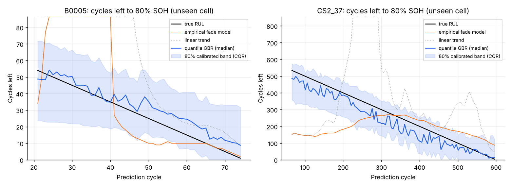

# Sprint 5: Remaining Useful Life (RUL) Prediction

**Planned week:** Week 5 (Mon 30 Nov - Fri 4 Dec 2026) · **Git tag:** `sprint-05`

## Sprint goal
Predict how many cycles a battery has left before it reaches 80% SOH (end of first life) and 60% SOH (end of second life), with calibrated uncertainty.

## Backlog

| Item | Status |
| --- | --- |
| Ground-truth end-of-life from smoothed measured SOH | Done |
| Causal snapshots: predictor sees only cycles 1..k | Done |
| Baseline 1: linear trend | Done |
| Baseline 2: empirical fade model with accelerating "knee" term | Done |
| Quantile Gradient Boosting (10/50/90%) | Done |
| Conformalised quantile regression (CQR) calibration | Done |
| Tests | Done (5 new, 21 total) |

## What was built

| File | Purpose |
| --- | --- |
| `batterylife/models/rul.py` | Snapshots, three predictors, CQR, evaluation by life stage |
| `tests/test_rul.py` | End-of-life detection, known-curve recovery, targets, saved-result checks |
| `results/rul_predictions.csv`, `results/rul_metrics.json` | Every prediction and its metrics |

## Method
- **Input history:** the out-of-sample SOH estimates from Sprint 4 (median-smoothed, causal), never measured capacity. This is what a deployed BMS would have.
- **Empirical fade model:** soh(k) = p0 − p1·k − p2·(e^(p3·k) − 1), with linear loss plus accelerating loss.
- **Quantile GBR inputs:**
  - current SOH estimate
  - fade rate and fade acceleration over a recent window (15 cycles NASA, 60 CALCE)
  - charge signals
  - resistance
  - cycle count
- **Validation:** leave-one-cell-out.
- **CQR:** raw quantile bands are widened by the 80th percentile of conformity scores from inner cross-validation on the training cells.

## Results: RUL to 80% SOH (unseen cells)

| Dataset | Mean life to 80% | Method | MAE (cycles) | Error at 50% of life | 80% band coverage |
| --- | --- | --- | --- | --- | --- |
| NASA | 72 cycles | Linear trend | 78.9 | 138 | n/a |
| NASA | 72 cycles | Fade model | 55.9 | 104 | n/a |
| NASA | 72 cycles | **Quantile GBR** | **8.2** | **12** | **75.9%** |
| CALCE | 578 cycles | Linear trend | 388.8 | 351 | n/a |
| CALCE | 578 cycles | Fade model | 145.4 | 45 | n/a |
| CALCE | 578 cycles | **Quantile GBR** | **46.6** | 62 | **78.6%** |

**RUL to 60% SOH (second-life floor), CALCE:** quantile GBR MAE 55.4 cycles over a mean life of 790 cycles, R² 0.89, band coverage 84.0%. On NASA only B0006 reaches 60%, so only the fade model applies there (MAE 50.4 cycles).

## Findings
- **Extrapolation fails before the knee.** CALCE cells fade slowly and then sharply after about 600 cycles. A curve fitted on pre-knee history cannot know when the knee will come. The learned model sees the knee in the training cells and anticipates it.
- **Regeneration breaks trend models on NASA.** After rest periods capacity jumps up, the fitted slope turns flat or positive, and extrapolation hits the 400-cycle horizon.
- **Uncalibrated quantile bands were dangerously narrow:** 22-33% coverage at a nominal 80%. CQR brings it to 76-84%. The bands are wide at the start of life, and they should be.

## Next sprint
Second-life grading, application matching and sustainability value.
