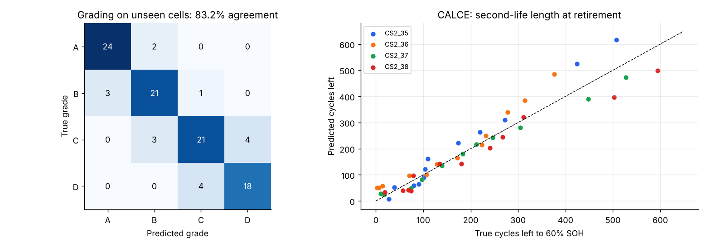

# Sprint 6: Second-Life Grading, Application Matching and Value

**Planned week:** Week 6 (Mon 7 Dec - Fri 11 Dec 2026) · **Git tag:** `sprint-06`

## Sprint goal
Turn SOH and RUL predictions into a lifecycle decision for every retired battery, with honest confidence, and quantify the value of re-use.

## Backlog

| Item | Status |
| --- | --- |
| Application catalogue with requirements | Done (`config.APPLICATIONS`) |
| Rule engine: grade A-D with reasons | Done |
| Uncertainty-aware confidence and recommendation | Done |
| Service years in the matched application | Done |
| CO2 and economic value (per cell and per 60 kWh pack) | Done |
| Evaluation against lab-truth grades on unseen cells | Done |
| Tests | Done (12 new, 33 total) |

## What was built

| File | Purpose |
| --- | --- |
| `batterylife/lifecycle/grading.py` | `grade()`, `assess()`, `lifecycle_stage()` |
| `batterylife/lifecycle/sustainability.py` | Usable energy, CO2 avoided, value |
| `batterylife/lifecycle/second_life.py` | Fleet evaluation at 15 retirement levels; summary |
| `tests/test_lifecycle.py` | Rule table, confidence logic, value routes, saved-result checks |

## Application catalogue (project assumptions)

| Grade | Application | Min SOH | Max resistance growth | Min cycles left to 60% | Cycles per year |
| --- | --- | --- | --- | --- | --- |
| A | EV re-use / light e-mobility | 80% | x1.30 | 300 | 250 |
| B | Grid / home energy storage | 70% | x1.60 | 200 | 300 |
| C | Backup power (telecom, UPS) | 60% | x2.00 | 50 | 20 |
| D | Recycling | anything else | | | |

**Confidence rule:** the grade is recomputed with the lower 95% bound of SOH and the lower bound of cycles left. If it changes, the decision is low-confidence and a laboratory capacity test is recommended.

## Results (unseen cells, 101 decisions across 15 retirement levels)

| Metric | All | NASA | CALCE |
| --- | --- | --- | --- |
| Grade agreement with lab truth | **83.2%** | 87.8% | 80.0% |
| Agreement when confidence is high | **89.5%** | 91.7% | 87.9% |
| Decisions flagged low-confidence | 43.6% | 41.5% | 45.0% |
| Errors caught by the low-confidence flag | **64.7%** | 60.0% | 66.7% |
| Conservative errors (graded too low) | 7 | 2 | 5 |
| Optimistic errors (graded too high) | 10 | 3 | 7 |

- **Second-life length (CALCE):** predicted cycles from retirement to 60% are off by 33.6 cycles on average.
- **At the usual 80% retirement point:** 7 of 8 cells are graded B (stationary storage) and 1 is graded A. Scaled to a 60 kWh pack, re-use avoids an estimated 3.6 t CO2e (upper bound) and is worth about USD 2,480 versus about USD 480 for recycling credit, under the stated price assumptions.
- **Service years:** about 0.7 years in daily storage. This is short because laboratory cells are aged at full depth of discharge and high C-rate. Real packs cycle more gently, so read this as a relative ranking, not a forecast.

## Findings
- Most errors happen right at a grade boundary, which is where the low-confidence flag catches them.
- Optimistic errors matter more for safety than conservative ones. Requiring a lab test for every low-confidence decision removes most of them; the remaining optimistic errors are listed in `results/second_life_assessments.csv`.
- On NASA only B0006 reaches 60% SOH, so NASA grades use SOH and resistance only; the cycle criterion is applied where truth exists (CALCE).

## Next sprint
The Digital Battery Passport: schema, signatures, hash chain, roles and access levels.
