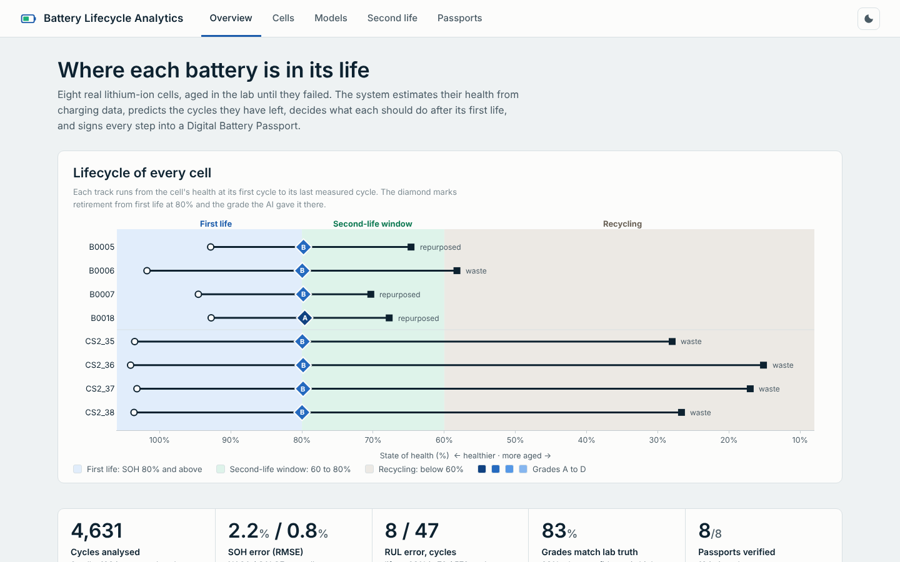
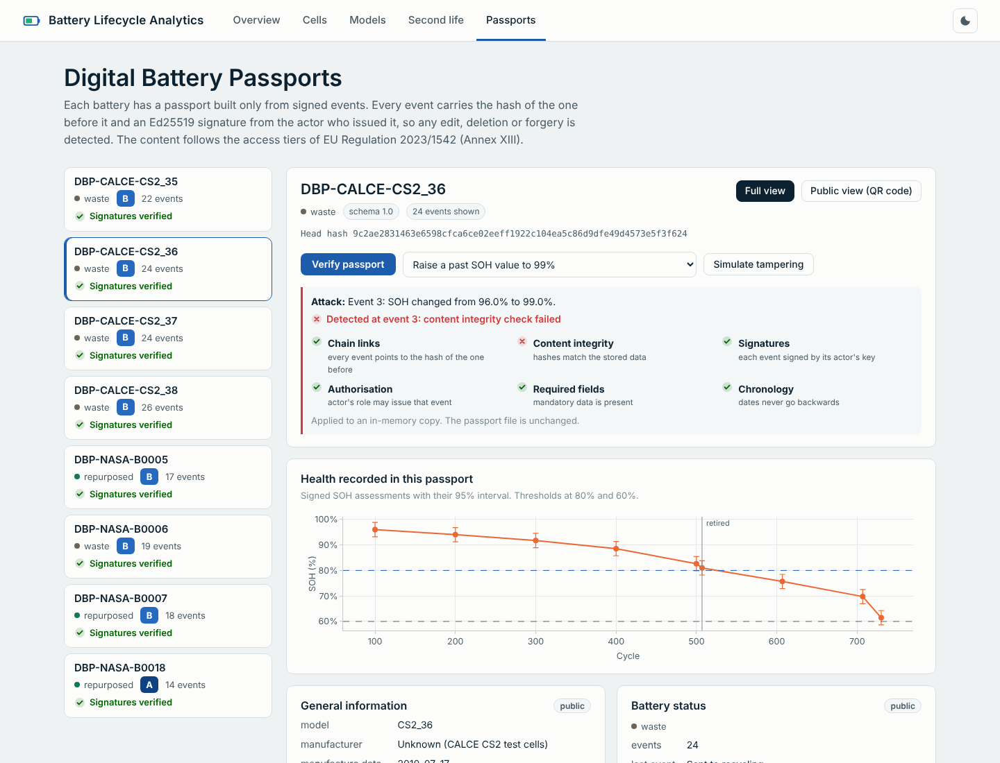

# Sprint 9: Analytics Dashboard

**Planned week:** Week 9 (Mon 28 Dec 2026 - Fri 1 Jan 2027) · **Git tag:** `sprint-09`

## Sprint goal
A web interface that shows the whole system: fleet health, per-cell analytics, model quality, second-life decisions and live passport verification.

## Backlog

| Item | Status |
| --- | --- |
| Flask API (12 endpoints) | Done |
| Overview with lifecycle band | Done |
| Cell explorer | Done |
| Model quality page | Done |
| Second-life page with live assessor | Done |
| Passport viewer: verify, tamper simulation, public view | Done |
| Light and dark themes, phone layout, offline charts | Done |
| API tests | Done (14 new, 61 total) |
| Windows launchers | Done (`run_dashboard.bat`, `run_pipeline.bat`) |

## What was built

| File | Purpose |
| --- | --- |
| `dashboard/app.py` | Flask app; NaN-safe JSON; passport verify and tamper endpoints |
| `dashboard/templates/*.html` | Five pages on one shared layout |
| `dashboard/static/js/*.js` | One script per page plus `common.js` (theme, Plotly defaults, helpers) |
| `dashboard/static/css/app.css` | Design tokens, light and dark themes, responsive layout |
| `dashboard/static/js/plotly-cartesian.min.js` | Plotly 3.x cartesian bundle (MIT), bundled so the app runs offline |
| `tests/test_dashboard.py` | Pages render, strict JSON, assessor validation, public view, all 5 attacks detected |

## Pages

| Page | What it answers |
| --- | --- |
| Overview | Where each battery is in its life (lifecycle band), headline accuracy, fleet SOH, passport status |
| Cells | For one cell: measured vs estimated SOH with interval, RUL vs truth, health indicators, decisions at 15 retirement levels |
| Models | SOH error by model and feature set, per-cell errors, feature importance, correlations, RUL method comparison |
| Second life | Interactive assessor, confusion matrix, predicted vs true second-life length, rules and assumptions |
| Passports | Sections by access tier, signed SOH history, event ledger, verify button, five attack simulations |

## Design decisions
- **Visual identity:** an engineering instrument-panel look in place of a generic card dashboard.
  - Bahnschrift (the DIN-style face built into Windows) for headings and figures.
  - Cool mineral background with cobalt ink.
  - The lifecycle band as the one signature element.
- **Charts:**
  - A colour-blind-safe categorical palette, checked with a palette validator (worst adjacent colour-blind ΔE 9.1).
  - Each cell keeps the same colour on every page.
  - Grades use a one-hue ordinal ramp.
  - Every chart has a legend or direct labels and hover details.
- **Uncertainty is always visible:** SOH bands, RUL bands, and an amber low-confidence state in the assessor.
- **Tamper simulation runs on an in-memory copy;** the tests confirm the file on disk still verifies afterwards.

## Issues found and fixed
| Issue | Fix |
| --- | --- |
| Browser rejected the summary: `NaN` is not valid JSON (CALCE has no temperature) | Custom JSON provider converts NaN and infinity to null for every endpoint |
| End-of-line labels overlapped on the CALCE chart | Label dodging in `common.js` |
| Low confidence looked like an error (red) | Amber caution style with its own icon |

## Next sprint
Final report, documentation, release.
